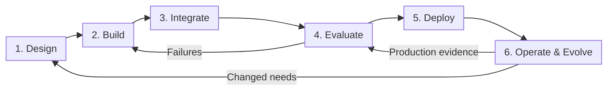
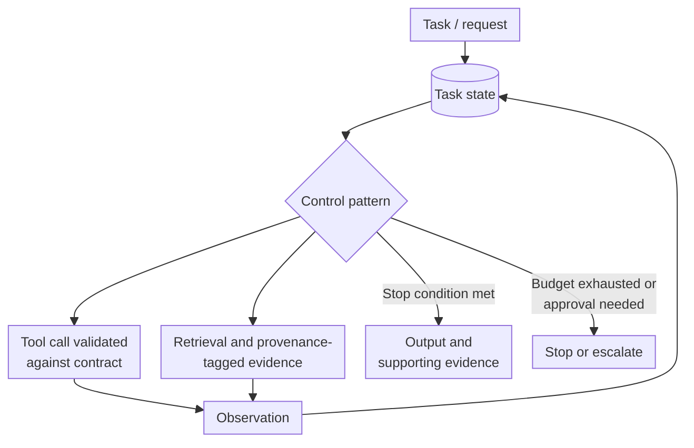
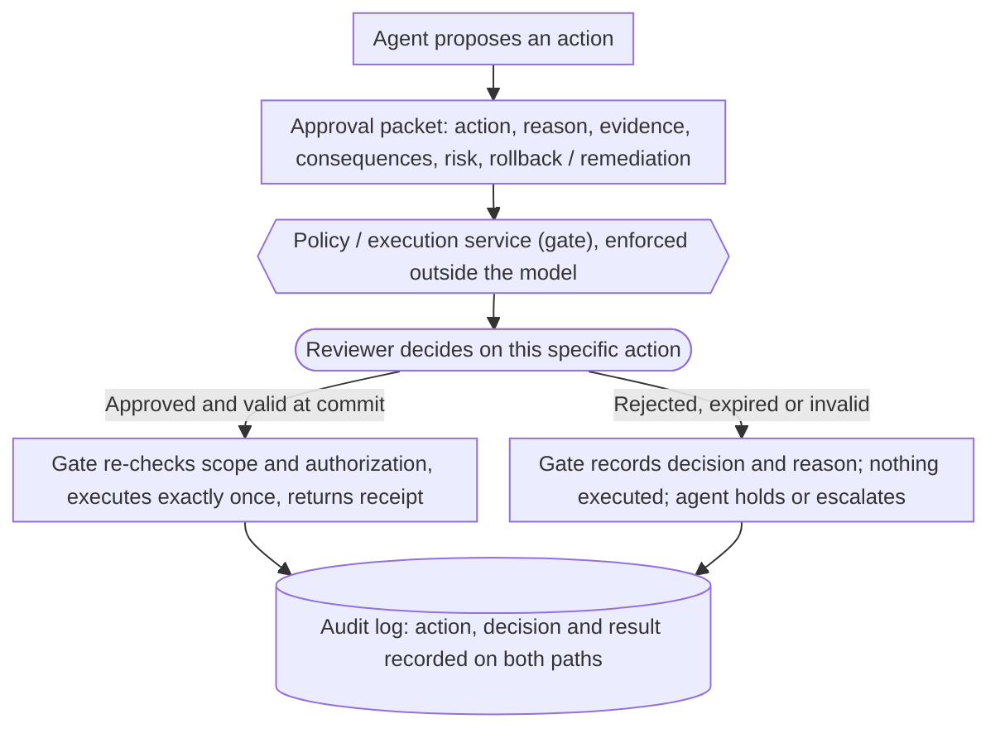
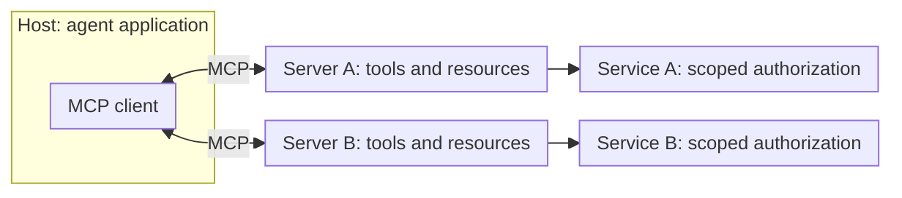
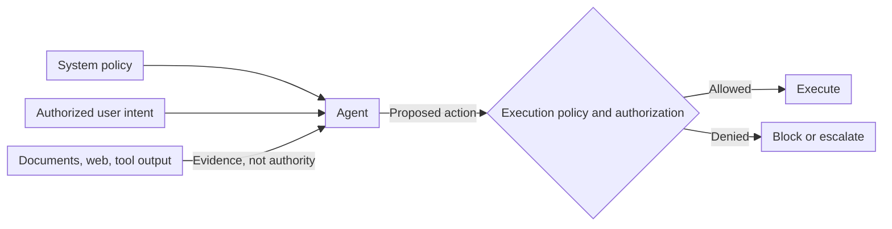
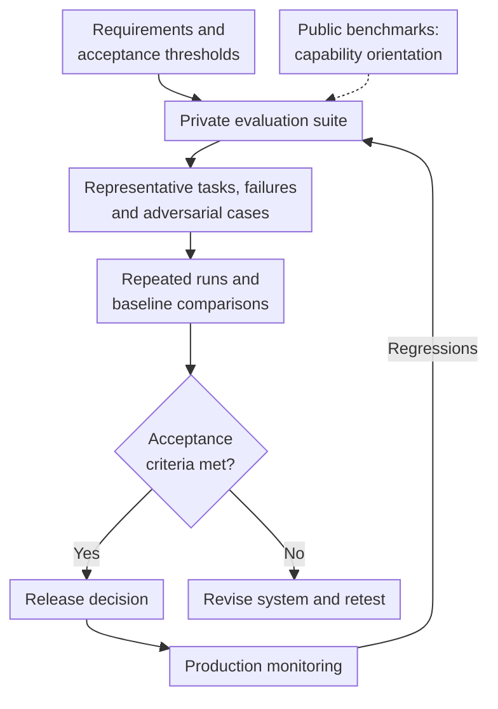
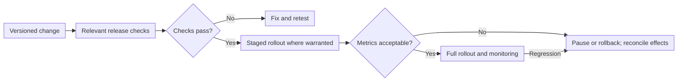

# Agentic AI Engineering Framework

A practical, technology-agnostic framework for engineering agentic AI systems, from initial problem discovery through production operation and continuous improvement.

The framework organizes the discipline into six interconnected stages, providing guidance on key decisions, engineering patterns, trade-offs, governance considerations and common pitfalls. Use it as a guide when scoping a new agent or workflow, or as a reference when reviewing an existing one.

---

## Framework at a Glance

| Stage | Core question | Focus |
|---|---|---|
| 1. Design | What should we build? | Value, requirements, architecture, boundaries |
| 2. Build | How do we implement it? | Models, control patterns, tools, grounding, state |
| 3. Integrate | How does it connect safely? | Identity, connectivity, data access, trust boundaries |
| 4. Evaluate | Does it meet expectations? | Quality, safety, reliability, cost |
| 5. Deploy | Is it ready for production? | Runtime, release readiness, rollback |
| 6. Operate & Evolve | Does it remain effective? | Observability, incidents, improvement, retirement |

The stages are engineering concerns, not a rigid waterfall. Small projects may move through several stages in a single iteration. Evaluation begins with requirements and continues throughout development; production findings can challenge earlier assumptions.

## Foundational Principles

- **Simplicity:** Choose the simplest architecture that satisfies the requirements. Additional tools, models, agents and orchestration must earn their place.
- **Proportionality:** The level of architectural complexity, documentation, testing and oversight should be proportionate to the system's autonomy, risk and potential impact.
- **Technology independence:** Keep engineering decisions, contracts and evaluation criteria applicable across models, vendors, SDKs and infrastructure wherever practical.
- **Evidence-driven engineering:** Use experiments, evaluations and production observations rather than assumptions or successful demos alone.
- **Bounded autonomy:** Define what an agent may do, what it must not do and when it must stop or escalate.

### Risk Tiers

For example, a team might tier its systems as follows. Adapt the tiers to your own risk appetite and regulation; the point is to decide depth of controls deliberately.

| Example tier | Typical signs | Suggested depth |
|---|---|---|
| Low | Read-only or advisory, local use, no sensitive data | Define purpose and non-goals, a basic evaluation, simple logging |
| Medium | Writes to internal systems or drafts for human approval, internal data | All stages, with enforced approvals, scoped credentials, a private evaluation suite and an accountable owner |
| High | External or irreversible actions, money, production systems, personal or customer data, multi-tenant | All stages in full, including adversarial testing, staged release, incident response and audit records |

If two tiers seem to fit, apply the higher. A human approval step lowers the tier only if it is enforced outside the model and the approver can see what will happen.

## Governance as a Continuous Engineering Discipline

Governance is not a separate lifecycle stage. It influences decisions throughout the lifecycle by establishing what an agent may do, under what conditions and with what accountability.

Design establishes autonomy, data access and acceptable risk; build and integration turn those boundaries into technical controls; evaluation tests their effectiveness; deployment and operation enforce, monitor and reassess them.

Four related disciplines answer different questions:

| Discipline | Fundamental question |
|---|---|
| Governance | Who decides, who is accountable, and what rules apply? |
| Risk management | What could go wrong, and is that risk acceptable? |
| Security | How are the system, its data and its actions protected? |
| Assurance | What evidence demonstrates that requirements are satisfied? |

A read-only research assistant does not require the same controls as an agent authorized to execute financial transactions. 

**Example — refund authorization:** If an agent must never issue a refund without authorization, design defines its authority to recommend but not independently execute refunds; implementation separates draft and commit and enforces authorization outside the model; evaluation tests bypass attempts; deployment requires those tests to pass; operation monitors and audits executed refunds. A single governance requirement becomes a concrete engineering constraint throughout the lifecycle.

---

## Stage 1 — Design: Requirements Before Architecture

**Objective:** Define a bounded system, its success criteria and the simplest architecture that can satisfy them.

### Problem and agent suitability

Start with the user, the existing process and the intended outcome. Identify what currently costs time or money, where errors occur and what improvement would justify building and maintaining a solution. Establish a baseline where possible: task completion time, quality, cost, volume or manual effort. Estimate the total cost of the proposed solution, including review, integration and maintenance, rather than token cost alone.

Screen the task before selecting an architecture:

| More suitable for an agent | Reasons to constrain or avoid agency |
|---|---|
| Ambiguous, multi-step tasks | Tasks better described by stable rules |
| Tool-dependent, adaptive actions | Irreversible or high-impact actions |
| Observable and evaluable outcomes | Outcomes that cannot be reliably assessed |
| Dynamic information or changing conditions | Restrictions on data access or delegation |

These are decision signals, not absolute exclusions. A regulated or high-impact workflow may still benefit from bounded, advisory assistance. Consider deterministic automation, a model-enhanced workflow, human assistance or no automation before defaulting to an agent.

Identify affected users, sensitive data, potentially harmful outcomes, applicable restrictions and who can decide whether the use case is acceptable. Establish an initial risk and impact assessment; a short note may be sufficient for a low-risk project.

### Requirements and architecture

Start with a product definition, not a model call:

| Decide | Captures |
|---|---|
| Who it serves | User role, job-to-be-done |
| What it may do | Autonomy level, tool inventory, data boundaries |
| What it must not do | Explicit non-goals (e.g. classify and draft, never issue refunds independently) |
| What counts as success | Measurable success metrics and acceptance thresholds |
| Where accountability lies | Owner, supervision points, escalation path |

Write requirements so they convert directly into evaluation cases ("must cite sources" → citation-relevance check). Identify representative tasks and a **failure taxonomy**: output errors, incorrect actions, policy violations, reliability or cost failures. Define an initial evaluation strategy before implementation.

Select the architecture family before choosing an implementation framework:

| Architecture | When to use it |
|---|---|
| Deterministic workflow | Rules and sequence are known; predictable execution matters |
| Model-enhanced workflow | A known process needs classification, extraction or generation at selected steps |
| Single bounded agent | Task requires adaptive tool use within clear limits |
| Planner–executor | Multi-step tasks benefit from explicit plans, execution and replanning |
| Multi-agent system | Distinct roles, independent verification or specialized capabilities justify coordination overhead |

These patterns can be combined. The choice depends on ambiguity, dependencies, reversibility, risk and the value of adaptation, not on how sophisticated the architecture appears.

Define the agent's identity and authorization model: which principal performs actions, when it acts on behalf of a user, and which permissions are available. Decide where task state lives and where human supervision or deterministic enforcement is needed.

Define autonomy boundaries, data restrictions, approval requirements and accountability before selecting tools. Distinguish actions that are automatic, require approval or are prohibited. Assess risks and choose controls that can be enforced outside model reasoning where necessary.

Test architectural, integration and safety assumptions with the smallest experiment that resolves the uncertainty. Use representative tasks, realistic tool responses, isolated environments and synthetic or authorized data. Reconsider the design if the evidence does not support it.

### Common pitfalls

Starting with a model or agent framework; automating a poorly understood process; assuming autonomy itself creates value; overlooking human review costs; vague success metrics; selecting a multi-agent architecture by default; relying on prompts alone for authorization; treating human oversight as a deployment-time addition.

### Readiness questions

- Is the problem and intended benefit clear enough to test?
- Have simpler alternatives and the existing process been considered, and is the proposed autonomy justified?
- Are purpose, non-goals, permissions and success criteria explicit?
- Have important architectural and safety assumptions been tested where necessary?
- Can requirements and safety boundaries be converted into tests?
- Is someone accountable for the system and its actions?

---

## Stage 2 — Build: Models, Control Patterns, Tools and State

**Objective:** Implement the selected architecture with explicit execution boundaries and recoverable behavior.

### Model selection

Compare candidate models on representative tasks using equivalent tool access, evaluation criteria and budgets. Measure task success, tool-call accuracy, latency, throughput and cost. Record versions and relevant configurations; test substitutions rather than assuming compatible APIs imply equivalent behavior.

### Control patterns

Control patterns determine when the agent plans, acts, observes, revises and stops.

| Pattern | What it does | Main risk | Control |
|---|---|---|---|
| ReAct loop | Reason → act → observe, repeat | Looping / drift | Budgets, stop rules |
| Plan → Execute | Separates planning from doing | Brittle plan | Replanning triggers |
| Reflection | Revises based on its own prior attempt | Self-confirmation | Ground revision in tests or evidence |
| Verifier | Checks output against policy, evidence or tests | Rubber-stamping | Independent criteria and deterministic checks where possible |

Choose patterns by task shape: flexible loops for exploration, plans for structured multi-step work, and verification for critical requirements. Model-based verification is fallible; non-negotiable permissions and safety invariants need enforceable controls.

### Multi-agent coordination

For multi-agent systems, define roles, delegation contracts, communication, ownership of shared state and how failures propagate. A coordinator should know which work completed, which failed and whether a retry is safe. Limit parallelism and delegation depth; add agents only where specialization or independent work justifies the overhead.

### Tool contracts and action boundaries

Tools need a narrow purpose, typed schemas, explicit side effects, validation and meaningful error responses. Classify calls by risk (read-only, draft, internal write, external action, financial, execution) and control them accordingly.

An agent's stated role and "must not" rules should match the tools it is actually granted. A role described as read-only or advisory that holds write or execution tools is only protected by its prompt. Review each agent's granted tools against its role, and remove or gate capabilities the role does not need. Where a runtime asks for confirmation per call, treat that as a control that depends on the user not auto-approving, and say so in the design.

For consequential state changes, use **draft/commit separation** or a dry-run/preview where feasible. A preview does not itself authorize an action: the execution service must independently enforce permissions and approval conditions at commit time.

| Oversight mode | How it works |
|---|---|
| Human-in-the-loop | Agent cannot proceed past a gate without explicit approval |
| Human-on-the-loop | Agent acts within bounds; a human monitors and can intervene |
| Human-over-the-loop | Humans govern through policies, audits and evaluation, not per-action approval |

An **approval packet** should give a reviewer the proposed action, reason, evidence, expected consequences, risk and available rollback or remediation option. Bind approvals to the specific action and relevant parameters; reject expired or materially changed requests.

### Grounding and retrieval

Choose between two-step RAG (retrieve once, then generate) and agentic RAG (iteratively retrieve, rewrite queries and assess evidence sufficiency) according to the task's need for adaptive evidence gathering. Preserve source provenance, access scope and freshness where relevant. Treat retrieved content as evidence, not as authority to change goals or permissions.

### State, memory and knowledge

| Layer | Holds | Lifespan |
|---|---|---|
| Context | What the model currently sees | One invocation |
| Task state | Objective, constraints, plan, completed steps, approvals | One run or resumable workflow |
| Memory | Preferences or facts persisted across runs | According to retention policy |
| Knowledge base | External evidence (documents, policies, APIs) | Independent of a run |
| Audit log | What happened, for accountability | Retained per policy; protected against unauthorized modification |

The system, not the model or chat transcript alone, should own task state explicitly. Define what may be written to memory, who authorizes it, how conflicts are resolved and how users can inspect or delete it where applicable. Retrieved knowledge for one task should not silently become long-term memory.

### Skills and procedure reuse

Package recurring procedures as **skills** where useful: load a short activation description first and detailed instructions only when the task matches (progressive disclosure). Version and review reusable procedures just as other behavioral configuration. Lifecycle hooks and scripts invoked as part of a skill are code with side effects too, and need the same review and version discipline (see Stage 6).

### Reliability and recovery

Define timeouts, bounded retries, execution budgets and stop conditions. Retry transient failures only when the operation is safe to repeat; use idempotency keys or equivalent deduplication for consequential writes. An uncertain result requires reconciliation before replaying an action that may already have succeeded.

Checkpoint durable workflows so they can resume from known state. Record completed side effects and provide compensating actions or human remediation where true rollback is impossible. Test recovery from tool outages, interrupted runs and partial completion.

### Common pitfalls

Unbounded loops; conflating state and memory; retrying non-idempotent actions blindly; trusting model-generated approvals; roles whose stated limits are not matched by their granted tools; adding multi-agent coordination without measurable benefit; open-ended proofs of concept; comparing models on different tasks or cherry-picking successful runs; optimizing token cost while ignoring task success and review time.

### Readiness questions

- Are model and control-pattern choices supported by representative workloads?
- Are tool contracts, action boundaries and stop conditions explicit and enforced?
- Is state recoverable where required, and are retries safe?
- Are evidence, memory and authority kept distinct?
- Have important implementation assumptions been tested?

---

## Stage 3 — Integrate: Connectivity, Identity and Data Access

**Objective:** Connect to external systems with scoped access and explicit trust boundaries.

### Integration and connectivity

Model Context Protocol (MCP) offers a reusable integration vocabulary: a **host** runs the application, a **client** connects to a **server**, and the server can expose tools, resources and prompts. MCP is an integration mechanism, not a security boundary by itself; hosts, servers and downstream services must enforce appropriate permissions.

- Separate read and write capabilities; begin with read-only access where practical.
- Use least privilege, scoped credentials and tenant isolation. Do not hand blanket tokens to the model.
- Identify the user or workload principal for each action, enforce delegated authorization, and manage credential expiry, rotation and revocation.
- Separate development, staging and production environments in proportion to risk. Use mock data and test systems before production access.
- Select hosted builders, code-first SDKs, graph-based or enterprise runtimes according to state, approval and operational needs. Keep contracts and evaluation sets portable where practical.
- Scripts or tooling that write secrets into configuration files should restrict file permissions, keep the files out of version control, avoid exposing them to other tools or agents, and have a rotation path. Prefer references to a secret store over copied values.

### Trust boundaries

Enforce **trust separation**: system policy and authorized user intent define permitted behavior; retrieved documents, emails, web pages and tool output cannot grant themselves authority or override those boundaries. Authenticated users are still subject to authorization and policy. Schema validation alone does not make content trustworthy.

Validate tool inputs and outputs, enforce permissions at the execution boundary, protect secrets, isolate tenants and sandbox untrusted execution. Log security-relevant decisions without unnecessarily retaining sensitive content. Select controls according to identified threats and their potential impact.

### Common pitfalls

Treating connector access as authorization; using overly broad credentials; copying secrets into plaintext configuration; treating schema validation as proof of trustworthiness; allowing retrieved content to override policy; overlooking integration failures or tenant isolation.

### Readiness questions

- Can integrations operate with appropriately scoped identities and permissions?
- Are read/write capabilities and environment boundaries appropriately separated?
- Is authorization enforced at execution, independently of model output?
- Are untrusted inputs prevented from granting authority or overriding policy?
- Are major integration or safety blockers resolved or understood?

---

## Stage 4 — Evaluate: Quality, Safety, Reliability and Cost

**Objective:** Establish evidence that the system meets its requirements and is suitable for its intended use.

**A demo is not an evaluation.** A successful run does not establish reliability. Evaluate the process (tool calls, retrieval, escalations and side effects) as well as the final answer, because a correct answer can hide a broken process. For multi-agent systems, evaluate routing (the right agent receives the task), the agreed workflow order, and hand-offs between agents and each hook, not only the final output. A team with no routing or workflow evaluation cannot show that having several agents is worth the overhead.

| Dimension | Example measures |
|---|---|
| Outcome | Task success, first-pass acceptance |
| Process | Tool-call correctness, groundedness, valid action sequence |
| Safety and oversight | Policy compliance, authorization failures, escalation appropriateness |
| Reliability | Repeated-run success, recovery behavior, variability |
| Efficiency | Latency, cost per run, human review time |
| Incremental value | Improvement over the existing process or simpler baseline |

Define acceptance thresholds based on design requirements and consequences of failure. For critical invariants, require deterministic enforcement and relevant tests rather than relying on average success rates.

Public benchmarks indicate model capability, not deployment readiness. Build a **private mini-benchmark** of representative tasks, edge cases, tool failures and adversarial inputs. Version cases, expected outcomes, model and configuration information. Keep cases used for tuning separate from held-out evaluation cases where feasible.

Run repeated trials for stochastic behavior. Choose sample sizes appropriate to variability, risk and the decision being made. Report the number of cases and runs alongside success rates; use uncertainty estimates where meaningful and avoid strong conclusions from small samples. Compare against baselines under equivalent conditions.

Prefer deterministic checks for structured outputs and permissions. Where human or model-based evaluators are needed, use explicit rubrics and calibrate against reviewed examples. Investigate disagreement and evaluator bias rather than treating an evaluator score as ground truth.

Rerun relevant regression cases when prompts, models, tools, policies or retrieval indexes change. Test model substitutions end to end, including tool use, latency and safety behavior. Add production failures to the evaluation suite when appropriate.

Test controls under both normal and adversarial conditions. For red-teaming, record the attacker goal, entry point, target asset, expected safe behavior and severity. Include relevant prompt injection, unauthorized actions, data leakage, approval bypass and cross-tenant access scenarios. A failed safety test should trigger remediation and reassessment according to its severity. Passing a test suite is evidence about tested paths, not proof of universal safety. An existing audit or review document is a claim to verify against the system, not evidence in itself.

### Common pitfalls

Evaluating final answers only; testing on examples used to tune the system; comparing inconsistent workloads; treating public benchmark scores or a model judge as certification; ignoring rare but severe failures.

### Readiness questions

- Have representative tasks, failures and adversarial cases been tested?
- Does the system meet its acceptance criteria across repeated runs?
- Does it outperform or meaningfully complement its baseline at acceptable cost?
- Is there evidence that relevant controls work, and can regressions be detected?

---

## Stage 5 — Deploy: Runtime Choice and Release Discipline

**Objective:** Release a compatible, tested system with appropriate safeguards and a practical recovery path.

Match execution to task shape and risk. These runtime patterns can be combined.

| Pattern | Best for |
|---|---|
| Synchronous API service | Short request/response tasks |
| Asynchronous queue worker | Long-running tasks, task IDs and background processing |
| Durable checkpointed workflow | Interrupted tasks, resumable execution and human review mid-run |
| Sandbox runtime | Isolated code execution, file access and browser interaction |

Treat prompts, tool schemas, model versions, policies, retrieval indexes and lifecycle hooks as **deployable code or configuration**. Track compatible combinations and make changes reproducible; pin versions where supported. A prompt change can shift behavior as much as a code change.

Use proportionate release checks: static validation, representative golden tasks, security regressions and staging runs as relevant. For consequential systems, consider shadow testing or canary releases, monitor defined metrics, and expand rollout only when results remain acceptable. A small low-risk application may need only a repeatable smoke test and a known previous version.

Plan rollback of model, prompt, tool and configuration changes together where compatibility requires it. Decide how to handle in-flight tasks, state migrations and already-completed external actions. Rolling back software does not undo a refund, message or other side effect; reconciliation or compensation may be needed.

Verify production permissions, oversight mechanisms, data handling, monitoring and applicable approval requirements before release. Make release decisions on relevant evaluation evidence and remaining risk. For higher-impact deployments, identify who can authorize release, pause the system or accept residual risk.

### Common pitfalls

Changing prompts directly in production without regression checks; enabling production access before controls are tested; assuming rollback reverses external actions; releasing without observability.

### Readiness questions

- Is the deployed combination of models, prompts, tools and policies tested and identifiable?
- Are production permissions and monitoring ready?
- Is there a practical release, rollback and in-flight recovery plan appropriate to the risk?

---

## Stage 6 — Operate & Evolve: Observability, Reliability and Continuous Improvement

**Objective:** Maintain system effectiveness, detect failures, respond to incidents and reassess whether the agent remains justified.

**Observability is a precondition for debugging and tuning.** Capture useful run-level evidence: input constraints, retrieval provenance, explicit plans or execution state when available, tool calls and results, policy decisions, final output and supporting evidence. Do not depend on access to private model reasoning. Correlate traces across tools and agents, redact sensitive content and set appropriate retention and access policies.

Monitor quality signals (task success, escalation rate, reviewer rejection rate), operational signals (latency, cost per run, token use, failures) and safety signals (blocked actions, unexpected side effects, incidents). Establish service-level objectives (SLOs) for the measures that matter: maximum acceptable latency or cost, minimum success rate and relevant safety or reliability thresholds.

Reliability and cost engineering include routing, fallbacks, caching where appropriate, capacity management and execution budgets. A model cascade can route simpler steps to cheaper or faster models and escalate difficult cases to stronger ones, provided evaluation supports the routing policy. Account for total cost: tools, hosting, review time and incident handling, not just tokens.

Keep an identifiable operational owner. Define how to pause execution, revoke credentials, contain failures, reconcile side effects and escalate incidents. Feed representative incidents, regressions and new tasks back into evaluation; revise design or implementation when evidence warrants it. Monitor model and connector changes as dependencies evolve.

Event-driven hooks and lifecycle scripts (run on prompts, tool use, file changes or session start) are code with side effects, not passive automation. Review what they read, write or send; ensure a hook failure cannot silently skip a control such as an audit entry or memory write; and test and version them like other behavioral configuration.

Periodically reassess value, reliability, risk and continued need. When retiring an agent, stop scheduled work, drain or cancel in-flight tasks safely, revoke credentials, remove unnecessary dependencies and dispose of stored state and memory in accordance with retention requirements. Preserve required audit records.

Monitor whether permissions, oversight and risk controls remain effective. Review material changes in purpose, scope, autonomy, model or data access. Keep sufficient records to reconstruct consequential actions and decisions, and ensure incidents have an accountable response owner.

For systems that warrant additional documentation, useful artifacts include an agent card (purpose, scope and limitations), data-flow map, model/tool inventory, permission summary, evaluation and red-team results, oversight plan and incident response plan. Combine these into a short document for simpler projects; use more formal evidence where required by risk or applicable obligations.

External references for deeper risk, governance and security guidance include NIST AI RMF, ISO/IEC 42001, the EU AI Act where applicable, and OWASP guidance on agentic AI security. Assess applicable legal and regulatory obligations separately.

### Common pitfalls

Monitoring cost but not quality; logging sensitive content indiscriminately; leaving incidents outside regression testing; untested model fallbacks; untested hooks that can silently bypass controls; keeping obsolete agents and credentials active.

### Readiness questions

- Can we identify and investigate significant failures or unauthorized actions?
- Are quality, reliability, cost and safety signals monitored at an appropriate level?
- Is someone responsible for incidents, dependency changes and eventual retirement?
- Does production evidence feed back into evaluation and design?

---

## Quick-Reference Checklist

Use when scoping or reviewing an agent; apply items according to risk and complexity.

### Design
- [ ] Intended value, existing baseline and simpler alternatives considered; key assumptions tested where needed.
- [ ] Purpose, non-goals, autonomy, success thresholds and accountable owner defined.
- [ ] Architecture, data boundaries and oversight justified.

### Build
- [ ] Model and control pattern suit representative workloads; skills and other behavioral components are versioned where used.
- [ ] Tool contracts, side effects, authorization and appropriate preview/approval mechanisms are explicit.
- [ ] Each agent's granted tools are checked against its stated role and non-goals; unneeded capabilities are removed or gated.
- [ ] Context, task state, memory, knowledge and audit records have distinct responsibilities.
- [ ] Execution budgets, stop conditions, retry safety and recovery match the risk.

### Integrate
- [ ] Scoped identities, least privilege, delegated authorization, read/write separation and environment isolation are appropriate.
- [ ] Secrets in generated or local configuration are permission-restricted, kept out of version control, and have a rotation path.
- [ ] Retrieved content retains provenance and cannot override policy or permissions.

### Evaluate
- [ ] Private evaluation cases cover representative tasks, failures and relevant adversarial inputs.
- [ ] Repeated runs, baseline comparisons and acceptance thresholds support intended use; relevant control and regression tests pass.

### Deploy
- [ ] Compatible versions are identifiable; release checks and production monitoring are ready.
- [ ] Rollback and recovery address in-flight work and external side effects.

### Operate & Evolve
- [ ] Quality, safety, reliability, latency and cost are monitored; routing and fallback behavior are tested where used.
- [ ] Hooks and lifecycle scripts are reviewed, tested and versioned, and cannot silently bypass a control.
- [ ] Consequential actions are auditable; incident response and retirement responsibilities are clear.
- [ ] Production failures feed back into evaluation; ongoing value and risk are reassessed.
