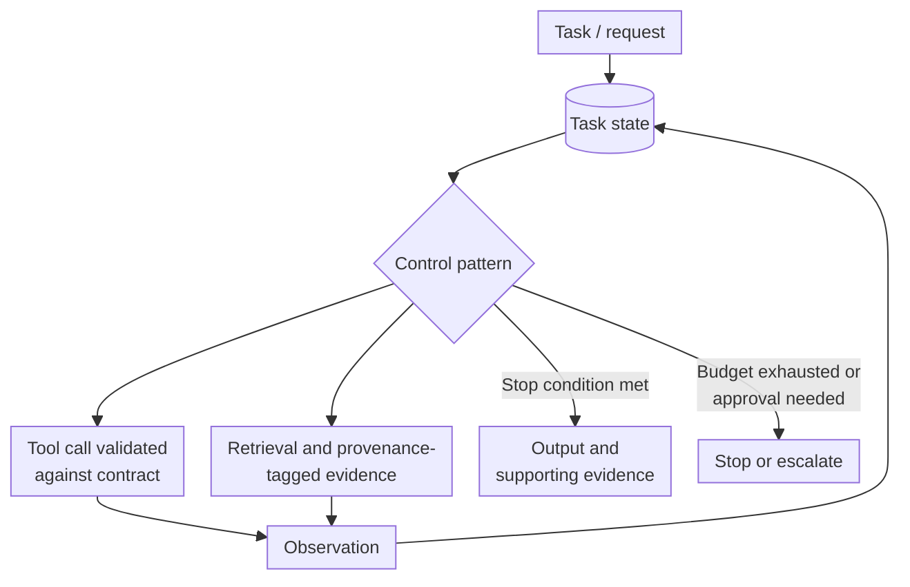
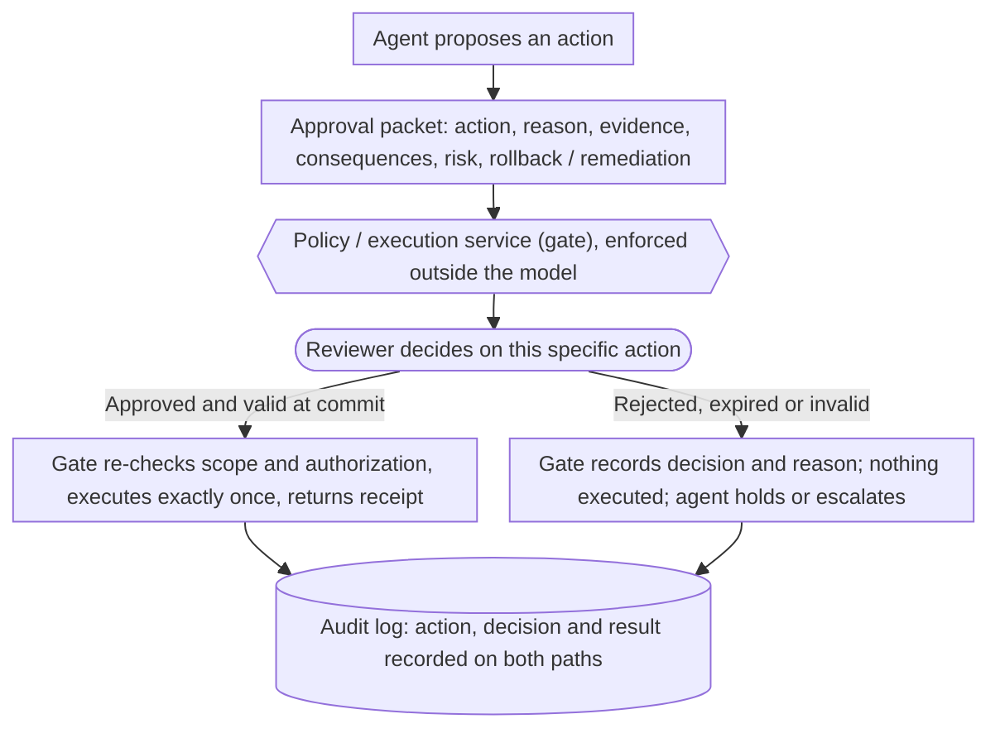

## Stage 2 — Build: Models, Control Patterns, Tools and State

**Objective:** Implement the selected architecture with explicit execution boundaries and recoverable behavior.

### Model selection

Compare candidate models on representative tasks using equivalent tool access, evaluation criteria and budgets. Measure task success, tool-call accuracy, latency, throughput and cost. Record versions and relevant configurations; test substitutions rather than assuming compatible APIs imply equivalent behavior.

### Control patterns

Control patterns determine when the agent plans, acts, observes, revises and stops.

| Pattern | What it does | Main risk | Control |
|---|---|---|---|
| ReAct loop | Reason → act → observe, repeat | Looping / drift | Budgets, stop rules |
| Plan → Execute | Separates planning from doing | Brittle plan | Replanning triggers |
| Reflection | Revises based on its own prior attempt | Self-confirmation | Ground revision in tests or evidence |
| Verifier | Checks output against policy, evidence or tests | Rubber-stamping | Independent criteria and deterministic checks where possible |

Choose patterns by task shape: flexible loops for exploration, plans for structured multi-step work, and verification for critical requirements. Model-based verification is fallible; non-negotiable permissions and safety invariants need enforceable controls.

### Multi-agent coordination

For multi-agent systems, define roles, delegation contracts, communication, ownership of shared state and how failures propagate. A coordinator should know which work completed, which failed and whether a retry is safe. Limit parallelism and delegation depth; add agents only where specialization or independent work justifies the overhead.

### Tool contracts and action boundaries

Tools need a narrow purpose, typed schemas, explicit side effects, validation and meaningful error responses. Classify calls by risk (read-only, draft, internal write, external action, financial, execution) and control them accordingly.

An agent's stated role and "must not" rules should match the tools it is actually granted. A role described as read-only or advisory that holds write or execution tools is only protected by its prompt. Review each agent's granted tools against its role, and remove or gate capabilities the role does not need. Where a runtime asks for confirmation per call, treat that as a control that depends on the user not auto-approving, and say so in the design.

For consequential state changes, use **draft/commit separation** or a dry-run/preview where feasible. A preview does not itself authorize an action: the execution service must independently enforce permissions and approval conditions at commit time.

| Oversight mode | How it works |
|---|---|
| Human-in-the-loop | Agent cannot proceed past a gate without explicit approval |
| Human-on-the-loop | Agent acts within bounds; a human monitors and can intervene |
| Human-over-the-loop | Humans govern through policies, audits and evaluation, not per-action approval |

An **approval packet** should give a reviewer the proposed action, reason, evidence, expected consequences, risk and available rollback or remediation option. Bind approvals to the specific action and relevant parameters; reject expired or materially changed requests.

### Grounding and retrieval

Choose between two-step RAG (retrieve once, then generate) and agentic RAG (iteratively retrieve, rewrite queries and assess evidence sufficiency) according to the task's need for adaptive evidence gathering. Preserve source provenance, access scope and freshness where relevant. Treat retrieved content as evidence, not as authority to change goals or permissions.

### State, memory and knowledge

| Layer | Holds | Lifespan |
|---|---|---|
| Context | What the model currently sees | One invocation |
| Task state | Objective, constraints, plan, completed steps, approvals | One run or resumable workflow |
| Memory | Preferences or facts persisted across runs | According to retention policy |
| Knowledge base | External evidence (documents, policies, APIs) | Independent of a run |
| Audit log | What happened, for accountability | Retained per policy; protected against unauthorized modification |

The system, not the model or chat transcript alone, should own task state explicitly. Define what may be written to memory, who authorizes it, how conflicts are resolved and how users can inspect or delete it where applicable. Retrieved knowledge for one task should not silently become long-term memory.

### Skills and procedure reuse

Package recurring procedures as **skills** where useful: load a short activation description first and detailed instructions only when the task matches (progressive disclosure). Version and review reusable procedures just as other behavioral configuration. Lifecycle hooks and scripts invoked as part of a skill are code with side effects too, and need the same review and version discipline (see Stage 6).

### Reliability and recovery

Define timeouts, bounded retries, execution budgets and stop conditions. Retry transient failures only when the operation is safe to repeat; use idempotency keys or equivalent deduplication for consequential writes. An uncertain result requires reconciliation before replaying an action that may already have succeeded.

Checkpoint durable workflows so they can resume from known state. Record completed side effects and provide compensating actions or human remediation where true rollback is impossible. Test recovery from tool outages, interrupted runs and partial completion.

### Common pitfalls

Unbounded loops; conflating state and memory; retrying non-idempotent actions blindly; trusting model-generated approvals; roles whose stated limits are not matched by their granted tools; adding multi-agent coordination without measurable benefit; open-ended proofs of concept; comparing models on different tasks or cherry-picking successful runs; optimizing token cost while ignoring task success and review time.

### Readiness questions

- Are model and control-pattern choices supported by representative workloads?
- Are tool contracts, action boundaries and stop conditions explicit and enforced?
- Is state recoverable where required, and are retries safe?
- Are evidence, memory and authority kept distinct?
- Have important implementation assumptions been tested?
