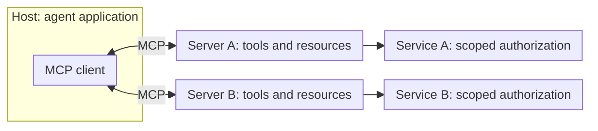
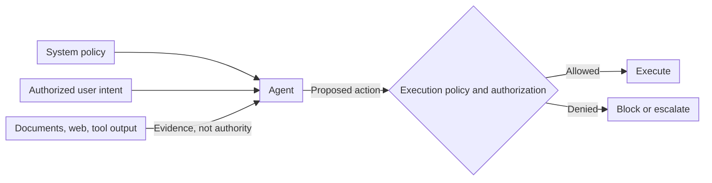

## Stage 3 — Integrate: Connectivity, Identity and Data Access

**Objective:** Connect to external systems with scoped access and explicit trust boundaries.

### Integration and connectivity

Model Context Protocol (MCP) offers a reusable integration vocabulary: a **host** runs the application, a **client** connects to a **server**, and the server can expose tools, resources and prompts. MCP is an integration mechanism, not a security boundary by itself; hosts, servers and downstream services must enforce appropriate permissions.

- Separate read and write capabilities; begin with read-only access where practical.
- Use least privilege, scoped credentials and tenant isolation. Do not hand blanket tokens to the model.
- Identify the user or workload principal for each action, enforce delegated authorization, and manage credential expiry, rotation and revocation.
- Separate development, staging and production environments in proportion to risk. Use mock data and test systems before production access.
- Select hosted builders, code-first SDKs, graph-based or enterprise runtimes according to state, approval and operational needs. Keep contracts and evaluation sets portable where practical.
- Scripts or tooling that write secrets into configuration files should restrict file permissions, keep the files out of version control, avoid exposing them to other tools or agents, and have a rotation path. Prefer references to a secret store over copied values.

### Trust boundaries

Enforce **trust separation**: system policy and authorized user intent define permitted behavior; retrieved documents, emails, web pages and tool output cannot grant themselves authority or override those boundaries. Authenticated users are still subject to authorization and policy. Schema validation alone does not make content trustworthy.

Validate tool inputs and outputs, enforce permissions at the execution boundary, protect secrets, isolate tenants and sandbox untrusted execution. Log security-relevant decisions without unnecessarily retaining sensitive content. Select controls according to identified threats and their potential impact.

### Common pitfalls

Treating connector access as authorization; using overly broad credentials; copying secrets into plaintext configuration; treating schema validation as proof of trustworthiness; allowing retrieved content to override policy; overlooking integration failures or tenant isolation.

### Readiness questions

- Can integrations operate with appropriately scoped identities and permissions?
- Are read/write capabilities and environment boundaries appropriately separated?
- Is authorization enforced at execution, independently of model output?
- Are untrusted inputs prevented from granting authority or overriding policy?
- Are major integration or safety blockers resolved or understood?
