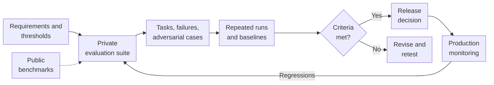

## Stage 4 — Evaluate: Quality, Safety, Reliability and Cost

**Objective:** Establish evidence that the system meets its requirements and is suitable for its intended use.

**A demo is not an evaluation.** A successful run does not establish reliability. Evaluate the process (tool calls, retrieval, escalations and side effects) as well as the final answer, because a correct answer can hide a broken process. For multi-agent systems, evaluate routing (the right agent receives the task), the agreed workflow order, and hand-offs between agents and each hook, not only the final output. A team with no routing or workflow evaluation cannot show that having several agents is worth the overhead.

| Dimension | Example measures |
|---|---|
| Outcome | Task success, first-pass acceptance |
| Process | Tool-call correctness, groundedness, valid action sequence |
| Safety and oversight | Policy compliance, authorization failures, escalation appropriateness |
| Reliability | Repeated-run success, recovery behavior, variability |
| Efficiency | Latency, cost per run, human review time |
| Incremental value | Improvement over the existing process or simpler baseline |

Define acceptance thresholds based on design requirements and consequences of failure. For critical invariants, require deterministic enforcement and relevant tests rather than relying on average success rates.

Public benchmarks indicate model capability, not deployment readiness. Build a **private mini-benchmark** of representative tasks, edge cases, tool failures and adversarial inputs. Version cases, expected outcomes, model and configuration information. Keep cases used for tuning separate from held-out evaluation cases where feasible.

Run repeated trials for stochastic behavior. Choose sample sizes appropriate to variability, risk and the decision being made. Report the number of cases and runs alongside success rates; use uncertainty estimates where meaningful and avoid strong conclusions from small samples. Compare against baselines under equivalent conditions.

Prefer deterministic checks for structured outputs and permissions. Where human or model-based evaluators are needed, use explicit rubrics and calibrate against reviewed examples. Investigate disagreement and evaluator bias rather than treating an evaluator score as ground truth.

Rerun relevant regression cases when prompts, models, tools, policies or retrieval indexes change. Test model substitutions end to end, including tool use, latency and safety behavior. Add production failures to the evaluation suite when appropriate.

Test controls under both normal and adversarial conditions. For red-teaming, record the attacker goal, entry point, target asset, expected safe behavior and severity. Include relevant prompt injection, unauthorized actions, data leakage, approval bypass and cross-tenant access scenarios. A failed safety test should trigger remediation and reassessment according to its severity. Passing a test suite is evidence about tested paths, not proof of universal safety. An existing audit or review document is a claim to verify against the system, not evidence in itself.

### Common pitfalls

Evaluating final answers only; testing on examples used to tune the system; comparing inconsistent workloads; treating public benchmark scores or a model judge as certification; ignoring rare but severe failures.

### Readiness questions

- Have representative tasks, failures and adversarial cases been tested?
- Does the system meet its acceptance criteria across repeated runs?
- Does it outperform or meaningfully complement its baseline at acceptable cost?
- Is there evidence that relevant controls work, and can regressions be detected?
