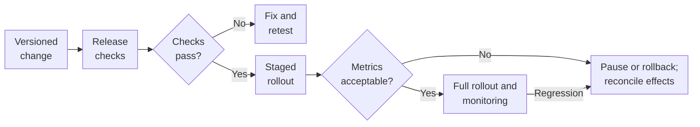

## Stage 5 — Deploy: Runtime Choice and Release Discipline

**Objective:** Release a compatible, tested system with appropriate safeguards and a practical recovery path.

Match execution to task shape and risk. These runtime patterns can be combined.

| Pattern | Best for |
|---|---|
| Synchronous API service | Short request/response tasks |
| Asynchronous queue worker | Long-running tasks, task IDs and background processing |
| Durable checkpointed workflow | Interrupted tasks, resumable execution and human review mid-run |
| Sandbox runtime | Isolated code execution, file access and browser interaction |

Treat prompts, tool schemas, model versions, policies, retrieval indexes and lifecycle hooks as **deployable code or configuration**. Track compatible combinations and make changes reproducible; pin versions where supported. A prompt change can shift behavior as much as a code change.

Use proportionate release checks: static validation, representative golden tasks, security regressions and staging runs as relevant. For consequential systems, consider shadow testing or canary releases, monitor defined metrics, and expand rollout only when results remain acceptable. A small low-risk application may need only a repeatable smoke test and a known previous version.

Plan rollback of model, prompt, tool and configuration changes together where compatibility requires it. Decide how to handle in-flight tasks, state migrations and already-completed external actions. Rolling back software does not undo a refund, message or other side effect; reconciliation or compensation may be needed.

Verify production permissions, oversight mechanisms, data handling, monitoring and applicable approval requirements before release. Make release decisions on relevant evaluation evidence and remaining risk. For higher-impact deployments, identify who can authorize release, pause the system or accept residual risk.

### Common pitfalls

Changing prompts directly in production without regression checks; enabling production access before controls are tested; assuming rollback reverses external actions; releasing without observability.

### Readiness questions

- Is the deployed combination of models, prompts, tools and policies tested and identifiable?
- Are production permissions and monitoring ready?
- Is there a practical release, rollback and in-flight recovery plan appropriate to the risk?
